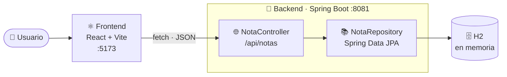

<div align="center">

# 📝 Notas Fullstack

**Una app de notas completa: API REST con Spring Boot + interfaz con React y Vite.**


</div>

---

## ✨ ¿Qué hace?

Permite **crear, listar, editar y eliminar notas** (CRUD). El frontend en React consume una API REST que guarda las notas en una base de datos H2 en memoria.

- 🎨 Interfaz cuidada: papel cálido, tipografía serif, una cinta de color por nota y modo oscuro automático.
- 📱 Diseño adaptable a móvil.
- 🔌 API REST sencilla, fácil de probar con Postman o `curl`.

## 🧭 Cómo funciona



1. El usuario interactúa con la interfaz de React (`frontend/`).
2. React hace peticiones `fetch` en JSON a la API (`backend/`).
3. `NotaController` recibe la petición y usa `NotaRepository` (Spring Data JPA).
4. JPA persiste la entidad `Nota` en la base de datos H2.

## 🔌 API

Base URL: `http://localhost:8081/api/notas`

| Acción | Método | Ruta | Body | Respuesta |
|---|---|---|---|---|
| Listar notas | `GET` | `/api/notas` | – | `200` + lista |
| Crear nota | `POST` | `/api/notas` | `{ "titulo", "descripcion" }` | `200` + nota creada |
| Editar nota | `PUT` | `/api/notas/{id}` | `{ "titulo", "descripcion" }` | `200` + nota, o `404` |
| Eliminar nota | `DELETE` | `/api/notas/{id}` | – | `204`, o `404` |

**Modelo `Nota`**

```json
{
  "id": 1,
  "titulo": "Comprar pan",
  "descripcion": "Y también leche"
}
```

Ejemplo con `curl`:

```bash
curl -X POST http://localhost:8081/api/notas \
  -H "Content-Type: application/json" \
  -d '{"titulo":"Mi primera nota","descripcion":"¡Funciona!"}'
```

## 🚀 Puesta en marcha

### Requisitos

- **JDK 17** o superior
- **Node.js 20+** y npm

### 1. Backend

```bash
cd backend
./mvnw spring-boot:run
```

En Windows: `mvnw.cmd spring-boot:run`. La API queda en `http://localhost:8081`.

### 2. Frontend

```bash
cd frontend
npm install
npm run dev
```

Abre `http://localhost:5173`.

> 💡 Si cambias el puerto o la URL del backend, define la variable `VITE_API_URL` (por ejemplo en `frontend/.env`):
> `VITE_API_URL=http://localhost:8081/api/notas`

## 🗄️ Consola de H2

Con el backend arrancado, abre `http://localhost:8081/h2-console` e inicia sesión con:

| Campo | Valor |
|---|---|
| JDBC URL | `jdbc:h2:mem:notasdb` |
| User Name | `sa` |
| Password | *(vacío)* |

> La base de datos es **en memoria**: los datos se pierden al reiniciar el backend.

## 🗂️ Estructura del proyecto

```
notas-fullstack/
├── backend/                         # API REST (Spring Boot)
│   ├── src/main/java/com/example/demo/
│   │   ├── DemoApplication.java     # Punto de entrada
│   │   ├── controller/NotaController.java   # Endpoints REST
│   │   ├── model/Nota.java                  # Entidad JPA
│   │   └── repository/NotaRepository.java   # Acceso a datos
│   ├── src/main/resources/application.properties
│   └── pom.xml
└── frontend/                        # Interfaz (React + Vite)
    ├── src/
    │   ├── App.jsx                  # Lógica y componentes
    │   ├── App.css                  # Estilos de la app
    │   └── index.css                # Tokens de diseño y tema
    └── package.json
```

## 🛠️ Tecnologías

| Capa | Tecnología |
|---|---|
| Backend | Java 17, Spring Boot 4, Spring Web MVC, Spring Data JPA, Lombok |
| Base de datos | H2 (en memoria) |
| Frontend | React 19, Vite 8, CSS puro |
| Calidad | oxlint |

## 🔮 Próximos pasos

- [ ] Tests unitarios y de integración del backend
- [ ] Validación de datos con Bean Validation
- [ ] Persistencia real (PostgreSQL o MySQL)
- [ ] Análisis de calidad con SonarQube

---

<div align="center">Hecho con ☕ y mucho cariño</div>
